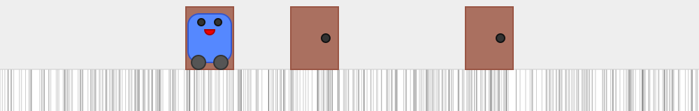
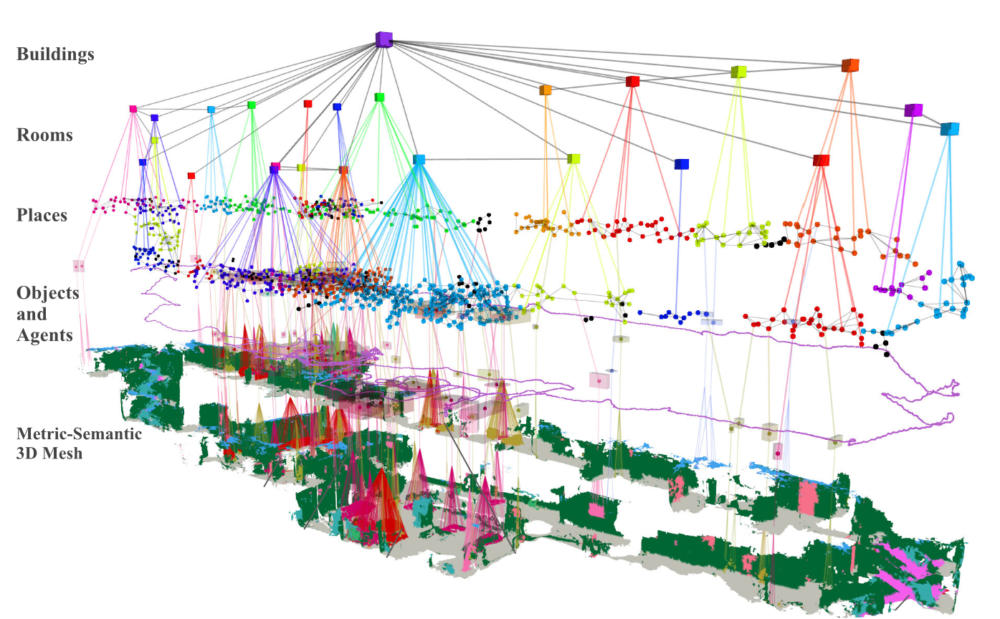

# WEEK 1: Report

## 2.1. 경로 계획 문제에서 샘플링이 필요한 이유 및 해당 알고리즘

* **샘플링이 필요한 이유:**
  * **Curse of Dimensionality 극복:** 다자유도 로봇이나 넓은 환경에서는 C-space(Configuration Space)의 장애물 영역($C_{obst}$)과 자유 공간($C_{free}$)의 기하학적 경계를 엄밀하게 계산하는 것이 불가능하거나 상당한 연산 비용을 초래한다.
  * **연산 효율성:** C-space 전체를 명시적으로 구축하지 않고, 무작위 샘플들을 생성하여 유효성(예를 들면: 충돌 여부)만 검사함으로써 고차원 공간에서도 Probabilistic Completeness을 유지하며 실행 가능한 경로를 빠르게 탐색할 수 있다.

* **해당하는 대표적 알고리즘:**
  * **PRM (Probabilistic RoadMap):** C-space에서 무작위 노드를 샘플링해 로드맵 그래프를 사전 구축하고 쿼리를 해결하는 다중 쿼리 알고리즘
  * **RRT (Rapidly-exploring Random Tree):** 시작점에서 목표 지점까지 공간을 점진적/무작위 트리 구조로 빠르게 확장하는 단일 쿼리 알고리즘
  * **변형 샘플링 기법:** Narrow corridor 문제를 완화하기 위한 **Visibility-based PRM**, **OBPRM (Obstacle-Based PRM)** 등

## 2.2. Kalman Filter의 정의 및 사용 시점

* **칼만 필터란?**
  * 베이지안 필터 프레임워크를 기반으로 하며, 시스템의 상태 추정 시 `Linearity`와 `Gaussian Noise`를 **가정**하여 상태의 **Mean**과 **Covariance**만을 재귀적으로 갱신하는 최적 추정 알고리즘이다.

* **언제 필요한가?**
  * 상태 전이 모델과 센서 관측 모델이 **Linear**이거나 선형화가 가능하고, 프로세스 노이즈 및 측정 노이즈가 Gaussian Distribution을 따르고 있다고 가정할 수 있을 때 사용된다.
  * Multi-modal Distribution이 아닌 **Single-modal Distribution**을 추적하며, 연산 자원이 제한되어 실시간으로 빠르고 가벼운 행렬 연산이 요구될 때 최적의 해를 제공한다.

## 2.3. Particle Filter의 정의 및 사용 시점

  
  *그림 1. MCL에서 파티클을 이용해 로봇의 위치를 표현하는 예시. 출처: [Daniel Lu, Wikimedia Commons](https://commons.wikimedia.org/wiki/File:Mcl_t_0_1.svg), CC BY-SA 3.0.*

* **파티클 필터란?**
  * 시스템의 Posterior PDF를 수많은 가상의 상태 후보인 Particle들의 분포로 근사하여 재귀적으로 위치 및 상태를 추정하는 몬테카를로 기반의 Non-parametric 베이지안 필터이다.

* **언제 필요한가?**
  * 시스템 모델이 심한 Non-linear을 띠거나, 노이즈가 정규분포를 따르지 않는 **Non-Gaussian** 환경일 때 필요하다.
  * 로봇이 어디에 있는지 모르는 'Global Localization'이나 환경의 대칭성으로 인해 위치 후보군이 여러 개 발생하는 **Multi-modal distribution** 문제를 풀어야 할 때 필수적이다.

## 2.4. Importance Sampling의 개념과 파티클 필터에서의 필요성

* **Importance Sampling 이란?**
  * 목표로 하는 확률 분포(Target Distribution, 예: 센서 정보가 반영된 실제 사후 확률)에서 직접 샘플을 추출하기 어려울 때, 샘플링하기 쉬운 제안 분포(Proposal/Importance Distribution, 예: 로봇의 모션 모델)에서 샘플을 먼저 추출한 뒤, 두 분포 간의 비율인 중요도 가중치(Importance Weight)를 부여하여 목표 분포의 기댓값이나 통계치를 근사하는 기법이다.

* **파티클 필터에서 필요한 이유:**
  * 로봇은 센서 관측값($z_t$)까지 통합된 복잡한 사후 확률 $p(x_t \mid z_{1:t}, u_{1:t})$에서 파티클을 직접 Sampling 할 수 없다.
  * 따라서 직전 파티클과 제어 입력($u_t$) 기반의 State Proposal Distribution을 통해 새로운 파티클 위치를 예측한 후, Measurement Likelihood $p(z_t \mid x_t)$에 비례하도록 파티클마다 중요도 가중치를 할당하여 목표 Posterior Distribution을 복원하기 위해 필요하다.

## 2.5. Localization 문제를 푸는 이유와 현실 대응 문제

* **Localization 문제를 푸는 이유:**
  * 이동 로봇이 주어진 지도 내에서 자신의 정확한 위치와 Pose을 알아야만 충돌 없이 목적지까지 도달하는 경로 계획 및 제어를 수행할 수 있기 때문이다.
  * 로봇 바퀴의 슬립, 센서 오차 등 외부적인(물리적) 요인으로 인해 이동 명령만을 누적하면 오차가 무한히 발산하므로 지속적인 보정이 필요하다.

* **현실에서 대응되는 문제:**
  * **로봇 청소기:** GPS가 수신되지 않는 아파트 내부에서 로봇이 충전 스테이션 위치와 현재 청소 중인 방의 위치를 파악하는 문제
  * **자율주행 자동차의 터널/도심 주행:** 고층 빌딩 사이나 길이가 긴 터널 속에서 GPS 음영이 발생했을 때 라이다/카메라와 정밀 지도를 매칭해서 현재 차선을 유지하는 문제
  * **스마트 팩토리의 무인이송차량(AGV/AMR):** 정해진 공장 내에서 자재를 운반할 때 자신의 상대 좌표를 파악하는 문제

## 2.6. Occupancy Grid Map의 정의 및 센서 측정을 통한 작성 방법

  
  *그림 2. 로봇의 지도 작성 및 위치 추정 결과 예시. 출처: [F. Fernando, Wikimedia Commons](https://commons.wikimedia.org/wiki/File:Robotic_map_topological_SLAM_localiztion.png), CC BY 4.0.*

* **Occupancy Grid Map 이란?**
  * 탐색 영역을 **일정한** 크기의 2차원(또는 3차원) Grid cell로 분할하고, 각 셀마다 장애물이 존재할 확률 $P(m_i = \text{occupied})$을 0과 1 사이의 값으로 표현한 지도 표현 방식이다.

* **센서 측정으로 만드는 방법 (Log-odds 역 센서 모델 업데이트):**

    1. **초기화:** 지도의 모든 셀 $i$의 점유 확률을 사전 지식이 없는 상태인 $0.5$ (Log-odds 값: $l_0 = 0$)로 초기화한다.
    2. **Ray-casting:** LiDAR나 초음파 센서로 물체까지의 거리 측정이 들어오면, 로봇의 현재 위치에서 빔 종단점까지의 직선 경로를 추적한다.
    3. **Inverse Sensor Model 적용:**
        * **빔이 통과한 셀:** 광선이 아무것도 부딪히지 않고 지나간 공간이므로 Free space로 판단하여 점유 확률을 낮춘다. ($l < 0$)
        * **빔이 끝나는 지점의 셀:** 반사가 일어난 장애물 위치이므로 Occupied 상태로 판단하여 점유 확률을 높인다. ($l > 0$)
    4. **Log-odds 덧셈 갱신:** 측정 데이터가 들어오면 각 셀의 로그-오즈 값을 갱신한다.
        * 측정 데이터가 들어올 때마다 베이즈 필터의 닫힌 형태인 로그-오즈 표현식을 사용하여 곱셈/나눗셈 없이 단순 누적 덧셈($l_{t,i} = l_{t-1,i} + \text{inv\_sensor}(z_t, x_t) - l_0$)으로 확률을 실시간 업데이트한다.
